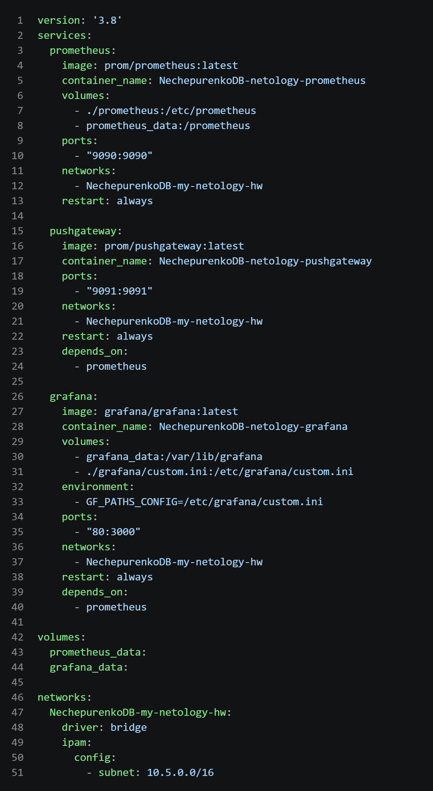
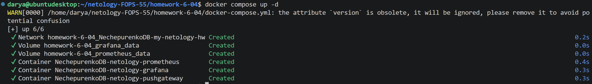
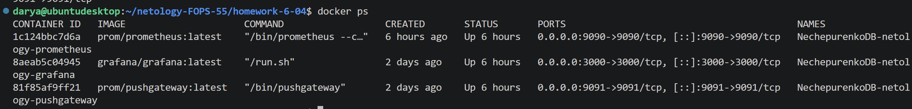
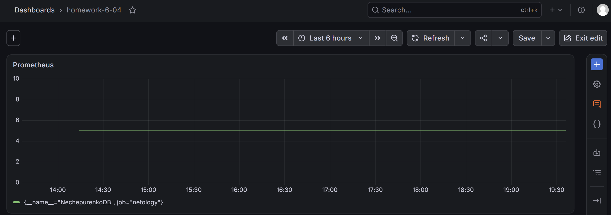
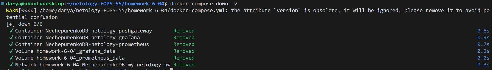

# 6.4. Docker. Часть 2. Нечепуренко Дарья

## Задания

### Задание 1
*Установите Docker Compose и опишите, для чего он нужен и как может улучшить лично вашу жизнь.*

### Задание 2
*Создайте файл docker-compose.yml и внесите туда первичные настройки:*

*version;*
*services;*
*volumes;*
*networks.*
*При выполнении задания используйте подсеть 10.5.0.0/16. Ваша подсеть должна называться: <ваши фамилия и инициалы>-my-netology-hw. Все приложения из последующих заданий должны находиться в этой конфигурации.*

### Задание 3
*Создайте конфигурацию docker-compose для Prometheus с именем контейнера <ваши фамилия и инициалы>-netology-prometheus.*
*Добавьте необходимые тома с данными и конфигурацией (конфигурация лежит в репозитории в директории 6-04/prometheus ).*
*Обеспечьте внешний доступ к порту 9090 c докер-сервера.*

### Задание 4
*Создайте конфигурацию docker-compose для Pushgateway с именем контейнера <ваши фамилия и инициалы>-netology-pushgateway.
Обеспечьте внешний доступ к порту 9091 c докер-сервера.*

### Задание 5
*Создайте конфигурацию docker-compose для Grafana с именем контейнера <ваши фамилия и инициалы>-netology-grafana.*
*Добавьте необходимые тома с данными и конфигурацией (конфигурация лежит в репозитории в директории 6-04/grafana.)*
*Добавьте переменную окружения с путем до файла с кастомными настройками (должен быть в томе), в самом файле пропишите логин=<ваши фамилия и инициалы> пароль=netology.*
*Обеспечьте внешний доступ к порту 3000 c порта 80 докер-сервера.*

### Задание 6
*Настройте поочередность запуска контейнеров.*
*Настройте режимы перезапуска для контейнеров.*
*Настройте использование контейнерами одной сети.*
*Запустите сценарий в detached режиме.*

### Задание 7
*Выполните запрос в Pushgateway для помещения метрики <ваши фамилия и инициалы> со значением 5 в Prometheus: echo "<ваши фамилия и инициалы> 5" | curl --data-binary @- http://localhost:9091/metrics/job/netology.*
*Залогиньтесь в Grafana с помощью логина и пароля из предыдущего задания.*
*Cоздайте Data Source Prometheus (Home -> Connections -> Data sources -> Add data source -> Prometheus -> указать "Prometheus server URL = http://prometheus:9090" -> Save & Test).*
*Создайте график на основе добавленной в пункте 5 метрики (Build a dashboard -> Add visualization -> Prometheus -> Select metric -> Metric explorer -> <ваши фамилия и инициалы -> Apply.*
*В качестве решения приложите:*
*docker-compose.yml целиком;*
*скриншот команды docker ps после запуске docker-compose.yml;*
*скриншот графика, построенного на основе вашей метрики.*

### Задание 8
*Остановите и удалите все контейнеры одной командой.*
*В качестве решения приложите скриншот консоли с проделанными действиями.*

## Ответы

### Задание 1

С помощью Docker Compose можно управлять всеми контейнерами одним файлом конфигурации. Это значительно сокращает время в работе, т.к. можно сразу запускать все контейнеры с определенными параметрами (тома, сети и др.) одной командой, не делая каждый раз это руками для каждого контейнера.

### Задания 2-7

    Скриншот файла docker-compose

    Запуск сценария командой docker compose up -d

    Результат команды docker ps

    График на основе метрики в Grafana

    

### Задание 8

    Остановка и удаление всех контейнеров командой docker compose down -v
 

